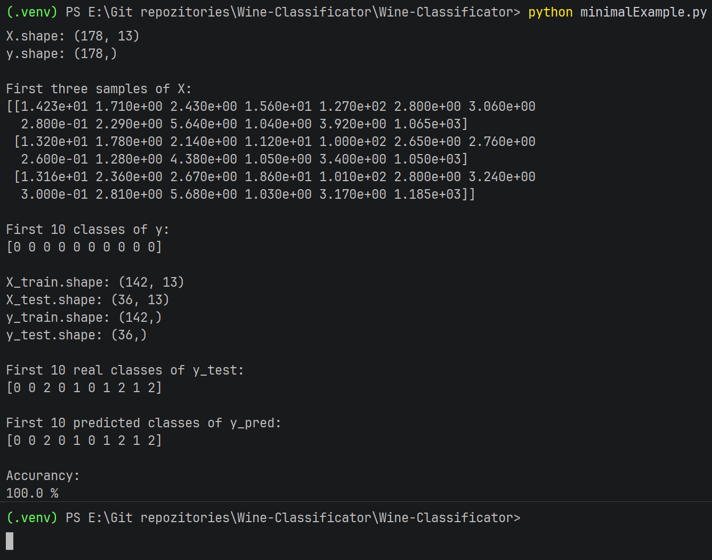
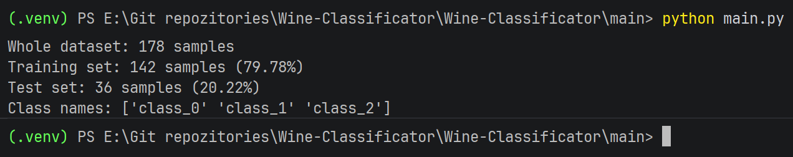

# Wine-Classificator

A system that recognizes the class of wine based on its chemical properties. The system compares algorithms, selects parameters and justifies the selection of the best solution.

## Explanation

We will use the load_wine set from the scikit-learn library. It contains 178 samples, 13 numerical features and three classes. It's a ready data set and each record has its own set of features and has its own class, we test locally whether our algorithms correctly predict what class a given feature vector will be in and compare it with real data downloaded from scikit-learn.

### What is scikit-learn?

Scikit-learn is a free Python library for classic machine learning. It has main, default algorithms and tools for preparing data, training models, evaluating and reaching the correct parameters for different engineer problems.

Scikit-learn is not a deep learning library like PyTorch or TensorFlow. It's best for classic ML models, prototyping, and tabular data; other tools are usually chosen for large neural networks.

### Main functions and research

1. Classification - Predicting categories, e.g., "which of the three classes does a sample belong to?"
2. Regression - Predicting a number such as price or temperature.
3. Clustering - automatic grouping of similar objects, e.g. k-means.
4. Dimension reduction - reducing the number of features, e.g. PCA.
5. Preprocessing - normalization, scaling, encoding of text data.
   Model evaluation and validation - division into training/test set, cross-validation, quality metrics.

## Requirements

Python newest version:

```powershell
python --version
```

Download latest python version here: https://www.python.org/

Project, all resources and libraries are set in python virtual environment. In order to use application, create new python environment:

```powershell
python -m venv environment_name
```

Then, use the environment:

```powershell
.\environment_name\Scripts\activate
```

Now inside the environment, update pip and install dependencies:

```powershell
python.exe -m pip install --upgrade pip
python -m pip install scikit-learn pandas matplotlib
```

### Main advantage of scikit-learn

It has a consistent API: most models are created, trained, and used in the same way - through fit(), predict(), and often transform() methods. This makes it easy to replace, for example, a decision tree with an SVM or a random forest without rewriting the entire logic. The library is open source, based, among others, on: on NumPy, SciPy and matplotlib, and works well with pandas.

What is the data? (ref: [sandbox/classesAndFeatures.py](sandbox/classesAndFeatures.py)):

```python
from sklearn.datasets import load_wine
import pandas as pd

# Load the Wine dataset from scikit-learn
wine = load_wine()

# Create a DataFrame containing all 13 numeric features
features = pd.DataFrame(
    wine.data,
    columns=wine.feature_names
)

# Add a column with the numeric class label (0, 1 or 2)
features["class"] = wine.target

# Add a readable class name, e.g. class_0, class_1, class_2
features["class_name"] = [wine.target_names[label] for label in wine.target]

# Print basic dataset information
print("Number of samples:", features.shape[0])
print("Number of features:", len(wine.feature_names))
print("Classes:", list(wine.target_names))

# Print the first 10 samples in a readable table
print("\nFirst 10 samples:")
print(features.head(10).to_string(index=False))

# Print how many samples belong to each class
print("\nSamples per class:")
print(features["class_name"].value_counts().to_string())
```


Minimal example (ref: [sandbox/classesAndFeatures.py](/sandbox/classesAndFeatures.py)):

```python
"""
    Download data
    → divide them into training and test ones
    → train the model on the training data
    → let the model predict classes for the test data
    → compare predictions with real classes
    → list accuracy
"""

from sklearn.datasets import load_wine
from sklearn.model_selection import train_test_split
from sklearn.ensemble import RandomForestClassifier
from sklearn.metrics import accuracy_score

X, y = load_wine(return_X_y=True)

print("X.shape:", X.shape)
print("y.shape:", y.shape)

print("\nFirst three samples of X:")
print(X[:3])

print("\nFirst 10 classes of y:")
print(y[:10])

X_train, X_test, y_train, y_test = train_test_split(
    X, y, test_size=0.2, random_state=42
)

print("\nX_train.shape:", X_train.shape)
print("X_test.shape:", X_test.shape)
print("y_train.shape:", y_train.shape)
print("y_test.shape:", y_test.shape)

model = RandomForestClassifier(random_state=42)
model.fit(X_train, y_train)

y_pred = model.predict(X_test)

print("\nFirst 10 real classes of y_test:")
print(y_test[:10])

print("\nFirst 10 predicted classes of y_pred:")
print(y_pred[:10])

print("\nAccurancy:")
print(accuracy_score(y_test, y_pred) * 100, "%")
# ex. Based on these 13 values, the model considers this wine to be class 0
```



Here, X are features, y are classes, and model.fit() trains the model on training data. predict() returns predicted classes for new samples.

## Investigation & usage

In order to run python files, use:

```powershell
python name_of_file.py
```

| File                                             | Responsibility                                 |
| ------------------------------------------------ | ---------------------------------------------- |
| [/main/dataset.py](/main/dataset.py)             | Data loading and train/test division           |
| [/main/analysis.py](/main/analysis.py)           | Statistics, missed values, class sizes         |
| [/main/visualization.py](/main/visualization.py) | Charts of training data                        |
| [/main/models.py](/main/models.py)               | Model definitions and parameter ranges         |
| [/main/evaluation.py](/main/evaluation.py)       | Validation, tuning, metrics and error analysis |
| [/main/main.py](/main/main.py)                   | Loading the whole experiment                   |

### How the data is divided into training and testing group?

Approximately 4/5 is training group and 1/5 is a testing group.



### Why do we need testing group?

When the machine learning model is training on the same data, the result and prediction will always be correct. In order to check, if the model is working correctly, we use testing data.

### Data set analysis, statistics, missing values

### Charts with class sizes, feature histograms, feature correlation map

### Three classificators

Here we will compare three algorithms:

| Model                   | What you will learn                                    |
| :---------------------- | :----------------------------------------------------- |
| **Logistic Regression** | Classification model with regularization               |
| **k-NN**                | Classification based on nearest neighbors              |
| **Decision Tree**       | Data splitting rules and the impact of tree complexity |

We must remember, that we don't want to scale the entire dataset, only the training group. This is for protection of loosing data.

1. **Logistic regression**: C controls the strength of regularization - a smaller C means stronger regularization.
2. **k-NN**: n_neighbors specifies the number of neighbors; weights the way their votes are weighted; p selection of distance.
3. **Tree**: max_depth limits the depth and min_samples_leaf limits the minimum number of samples in a leaf.

### Validation and tuning

Why do we choose F1 macro?
The task requires accuracy, precision, recall and F1. Let's count them all, but before experimenting, let's establish one main model selection metric: f1_macro.

Accuracy - the proportion of correct predictions.

Precision - what fraction of samples predicted as a given class actually belong to that class.
Recall - what fraction of real samples of a given class were detected.

F1 - harmonic mean precision and recall.

Macro - we calculate the score separately for each class, and then the average, giving the classes equal weight.

The best GridSearchCV result comes from the same folds where we selected the parameters, so it may be optimistic. Don't present it as an independent end result. This is what the postponed test is for.

### End test and mistakes analysis

How to read the confusion matrix?

- Row – actual class.
- Column - intended class.
- Diagonal - correct classifications.
- Remaining fields - errors.

If, for example, row class_1, column class_2 contains 2, it means that the model considered two samples of class class_1 as class_2.

Treat the training-validation difference as a guide, not an automatic verdict:

- very good training and significantly weaker validation may indicate overtraining;
- poor both results may indicate undereducation or inappropriate features/model;
- similar, high results are a favorable signal;
- large differences between folds indicate
  that the evaluation depends on the division of the data.

The learning curve applies to parameters already selected. This is a diagnostic tool, not an additional independent test.
