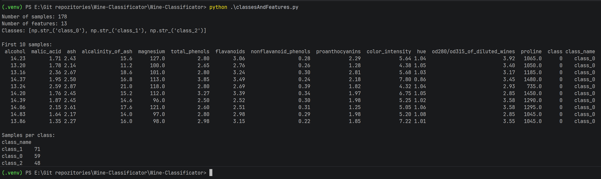

# Wine-Classificator
A system that recognizes the class of wine based on its chemical properties. The system compares algorithms, selects parameters and justifies the selection of the best solution.

## Explanation 
We will use the load_wine set from the scikit-learn library. It contains 178 samples, 13 numerical features and three classes. It's a ready data set and each record has its own set of features and has its own class, we test locally whether our algorithms correctly predict what class a given feature vector will be in and compare it with real data downloaded from scikit-learn.

### What is scikit-learn?
Scikit-learn is a free Python library for classic machine learning. It has main, default algorithms and tools for preparing data, training models, evaluating and reaching the correct parameters for different engineer problems.

Scikit-learn is not a deep learning library like PyTorch or TensorFlow. It's best for classic ML models, prototyping, and tabular data; other tools are usually chosen for large neural networks.

### Main functions and research
1. Classification - Predicting categories, e.g., "which of the three classes does a sample belong to?"
2. Regression - Predicting a number such as price or temperature.
3. Clustering - automatic grouping of similar objects, e.g. k-means.
4. Dimension reduction - reducing the number of features, e.g. PCA.
5. Preprocessing - normalization, scaling, encoding of text data.
Model evaluation and validation - division into training/test set, cross-validation, quality metrics.

### Main advantage of scikit-learn
It has a consistent API: most models are created, trained, and used in the same way - through fit(), predict(), and often transform() methods. This makes it easy to replace, for example, a decision tree with an SVM or a random forest without rewriting the entire logic. The library is open source, based, among others, on: on NumPy, SciPy and matplotlib, and works well with pandas.

What is the data? (ref: [classesAndFeatures.py](classesAndFeatures.py))
```python
from sklearn.datasets import load_wine
import pandas as pd

# Load the Wine dataset from scikit-learn
wine = load_wine()

# Create a DataFrame containing all 13 numeric features
features = pd.DataFrame(
    wine.data,
    columns=wine.feature_names
)

# Add a column with the numeric class label (0, 1 or 2)
features["class"] = wine.target

# Add a readable class name, e.g. class_0, class_1, class_2
features["class_name"] = [wine.target_names[label] for label in wine.target]

# Print basic dataset information
print("Number of samples:", features.shape[0])
print("Number of features:", len(wine.feature_names))
print("Classes:", list(wine.target_names))

# Print the first 10 samples in a readable table
print("\nFirst 10 samples:")
print(features.head(10).to_string(index=False))

# Print how many samples belong to each class
print("\nSamples per class:")
print(features["class_name"].value_counts().to_string())
```


Minimal example (ref: [minimalExample.py](classesAndFeatures.py)):
```python
from sklearn.datasets import load_wine
from sklearn.model_selection import train_test_split
from sklearn.ensemble import RandomForestClassifier
from sklearn.metrics import accuracy_score

X, y = load_wine(return_X_y=True)

X_train, X_test, y_train, y_test = train_test_split(
    X, y, test_size=0.2, random_state=42
)

model = RandomForestClassifier(random_state=42)
model.fit(X_train, y_train)

y_pred = model.predict(X_test)
print(accuracy_score(y_test, y_pred))
```
Here, X are features, y are classes, and model.fit() trains the model on training data. predict() returns predicted classes for new samples.

## Requirements
Project, all resources and libraries are set in python virtual environment. In order to use application, create new python environment: 
```powershell
python -m venv environment_name
```
Then, use the environment:
```powershell
.\environment_name\Scripts\activate
```
Now inside the environment, update pip and install dependencies:
```powershell
python.exe -m pip install --upgrade pip
python -m pip install scikit-learn pandas matplotlib
```

## Investigation & usage

